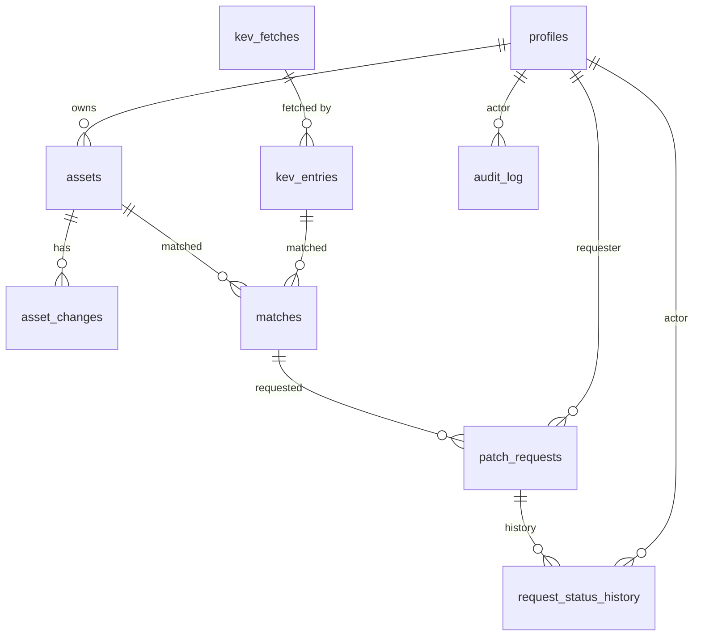

# ERD: smart-factory

> 연결: [PRD](../PRD.md) FR-xx · [IA](../IA.md) 화면 ID · [GLOSSARY](../../GLOSSARY.md) · ADR 0001~0003
> DB: Supabase(Postgres). 표·열 이름은 영어, 설명은 한국어. 실제 DB에 적용하기 전에 사용자에게 먼저 묻는다.

## 1. 관계도



## 2. 표

### profiles (사용자) — FR-01, FR-02
| 열 | 형식 | 설명 |
|---|---|---|
| id | uuid PK | Supabase 로그인 사용자 id와 같음 |
| display_name | text | 가상 이름 |
| role | text | `member`(담당자) / `admin`(관리자). 기본 `member`, 관리자는 DB에서 지정 |
| created_at | timestamptz | |

### assets (자산) — FR-03
| 열 | 형식 | 설명 |
|---|---|---|
| id | uuid PK | |
| owner_id | uuid FK → profiles | 담당자 |
| name | text | 자산 이름 |
| vendor / product / version | text | KEV 매칭에 쓰는 벤더·제품, 버전은 참고용 |
| category | text | `OT` / `IT` |
| asset_type | text | 자산 종류(PLC, HMI PC, 산업용 스위치, 방화벽 등) |
| zone / line | text | 구역(조립동 등) / 라인(조립 라인 1 등) |
| criticality | text | `high` / `mid` / `low` (중요도) |
| affected_equipment | text | 영향 설비(라인·설비 이름) |
| patch_constraints | text[] | `vendor_approval` / `no_downtime` / `maintenance_window` |
| rollback_possible | boolean | 되돌리기 가능 여부 |
| last_verified_at | timestamptz | 마지막 확인일 |
| is_active | boolean | 삭제 대신 비활성(이력 보존) |
| created_at / updated_at | timestamptz | |

### asset_changes (자산 변경 이력) — FR-04
| 열 | 형식 | 설명 |
|---|---|---|
| id | bigint PK | |
| asset_id | uuid FK → assets | |
| changed_by | uuid FK → profiles | |
| changed_at | timestamptz | |
| before / after | jsonb | 바뀌기 전·후 값 |

### kev_fetches (가져오기 기록) — FR-05, FR-06
| 열 | 형식 | 설명 |
|---|---|---|
| id | bigint PK | |
| trigger | text | `cron` / `manual` / `test` |
| started_at / finished_at | timestamptz | **받은 시각**은 마지막 성공 건의 finished_at |
| status | text | `ok`(읽음) / `empty`(내용 없음) / `failed`(못 읽음) |
| catalog_version | text | KEV `catalogVersion` |
| entry_count | int | |
| error_message | text | 실패 사유(비밀 정보 금지) |

### kev_entries (KEV 항목) — FR-05
| 열 | 형식 | 설명 |
|---|---|---|
| cve_id | text PK | `cveID` |
| vendor_project / product | text | 매칭 기준 |
| vulnerability_name / short_description / required_action | text | 원문 |
| date_added / due_date | date | `dateAdded`, `dueDate` |
| ransomware_known | boolean | `knownRansomwareCampaignUse = Known` |
| notes | text | |
| cwes | text[] | |
| source_fetch_id | bigint FK → kev_fetches | 마지막으로 갱신한 가져오기 |
| is_test | boolean | 시험 모드용 가짜 데이터 표시(FR-20) |

### matches (매칭) — FR-07, FR-08, FR-09
| 열 | 형식 | 설명 |
|---|---|---|
| id | uuid PK | |
| asset_id | uuid FK → assets | |
| cve_id | text FK → kev_entries | |
| status | text | `candidate`(후보) / `confirmed`(위험 항목) / `dismissed`(해당 없음) |
| decided_by / decided_at / note | | 확인한 사람·시각·메모 |
| score | int | 우선순위 점수 |
| score_breakdown | jsonb | 점수 구성(기한 초과 일수·랜섬웨어·중요도·최근 등록 각 점수) |
| scored_at | timestamptz | |
| unique(asset_id, cve_id) | | 같은 짝은 한 번만 |

### patch_requests (패치 요청) — FR-11~15
| 열 | 형식 | 설명 |
|---|---|---|
| id | uuid PK | |
| match_id | uuid FK → matches | `confirmed`인 짝만 |
| requester_id | uuid FK → profiles | |
| status | text | `submitted`(신청) / `approved`(승인) / `rejected`(반려) / `in_progress`(처리 중) / `done`(완료) / `on_hold`(보류) |
| action_type | text | `patch` / `mitigation`(완화 조치) |
| vendor_support | text | `yes` / `no` / `unknown` (호환성 확인) |
| tested | text | `yes` / `no` / `na` |
| rollback_plan | text | 되돌리기 계획 |
| downtime_impact | text | 가동 영향 |
| planned_date | date | 적용 예정일 |
| review_date | date | 재검토일(보류는 필수) |
| reason | text | 보류·완화·반려 사유 |
| result_note | text | 처리 결과(완료 시 필수) |
| created_at / updated_at / completed_at | timestamptz | |
| **부분 유일 색인** | | match_id당 진행 중(`submitted`·`approved`·`in_progress`·`on_hold`) 요청은 1건만 (Ex-04) |

### request_status_history (요청 상태 이력) — FR-16, KPI
| 열 | 형식 | 설명 |
|---|---|---|
| id | bigint PK | |
| request_id | uuid FK → patch_requests | |
| from_status / to_status | text | |
| actor_id | uuid FK → profiles | |
| at | timestamptz | **KPI(소요 시간)의 원천** |
| reason | text | 사유 |

### audit_log (활동 기록) — FR-19
자산 생성·수정, 확인(해당함/해당 없음), 데이터 가져오기, 권한 거부 등 **요청 상태 이외의 기록**.
| 열 | 형식 | 설명 |
|---|---|---|
| id | bigint PK | |
| actor_id | uuid FK → profiles (null 가능: 자동 실행) | |
| action | text | 예: `asset.update`, `match.confirm`, `kev.fetch` |
| entity_type / entity_id | text | |
| detail | jsonb | |
| at | timestamptz | |

### app_settings
| 열 | 설명 |
|---|---|
| key text PK / value jsonb | 예: `test_mode`(시험 모드 켜짐), `score_weights`(점수 가중치) |

## 3. 접근 규칙 (행 수준 보안, RLS) — FR-02
| 표 | 담당자 | 관리자 |
|---|---|---|
| profiles | 자기 행 읽기 | 전체 읽기, 역할 변경은 DB에서만 |
| assets · asset_changes | 자기 것만 읽기·쓰기 | 전체 읽기 |
| matches | 자기 자산의 것만 읽기, 확인(status 변경)만 | 전체 읽기 |
| patch_requests | 자기 요청만 읽기·신청·처리 | 전체 읽기, 승인·반려 |
| request_status_history · audit_log | 자기 요청·자산 관련만 읽기 | 전체 읽기 |
| kev_entries · kev_fetches | 읽기 | 읽기, 가져오기는 서버에서만 쓰기 |
| app_settings | 읽기 | 서버에서만 쓰기 |
- 쓰기가 필요한 외부 데이터(KEV)는 **서버 함수만** 서비스 키로 쓴다. 서비스 키는 브라우저에 보내지 않는다(ADR 없음, `CLAUDE.md` 비밀 규칙).

## 4. 점수 계산 (FR-09, 가정: spec·plan에서 확정)
`score = 기한 초과 일수 점수 + 랜섬웨어 악용(Known) 가산 + 중요도 점수 + 최근 등록 가산`. 각 항목 점수를 `score_breakdown`에 저장해 화면에 구성을 그대로 보여 준다. 가중치는 `app_settings.score_weights`에 두어 코드를 고치지 않고 조정한다.

## 5. 상태 전이 (patch_requests.status)
```
submitted → approved → in_progress → done
submitted → rejected → (재신청: 새 요청)
submitted/approved/in_progress → on_hold(사유·재검토일 필수) → approved 또는 in_progress(재검토 후)
```
모든 전이는 `request_status_history`에 한 행을 남긴다(누락 금지).

## 6. 화면 ↔ 표
| 화면 | 주로 읽고 쓰는 표 |
|---|---|
| DB-01-P | matches(confirmed 상위), patch_requests, kev_fetches |
| RK-01~05 | matches, kev_entries, assets |
| AS-01~03 | assets, asset_changes, matches |
| RQ-01~05 | patch_requests, request_status_history |
| AD-01~05 | 전 표(읽기), kev_fetches·app_settings(데이터 관리) |
| AD-06-P(Could) | request_status_history |

## 7. 시드 데이터 (FR-21)
가상 자산 115개(구역 9 · 라인별: 프레스·조립·도장·포장·물류·검사·수전·제어실·데이터센터·경계망, OT 91 · IT 24), 가상 사용자(담당자 3명·관리자 1명), 일부는 KEV와 맞고 일부는 맞지 않게 구성. 시험 모드용 KEV 샘플 `is_test=true`. 실제 회사·개인 정보 없음.

## 8. asset_events (자산 과거 이력) — FR-26(Could), 적용 완료
| 열 | 형식 | 설명 |
|---|---|---|
| id | bigint PK | |
| asset_id | uuid FK → assets | |
| kind | text | `incident`(장애) / `change`(변경) |
| occurred_on | date | 발생·시작일 |
| impact / resolved_after_days / handle_hours / reassignments | | 장애 항목 |
| risk / emergency / cab_needed / planned_downtime_minutes / actual_duration_minutes / had_related_incident | | 변경 항목(`had_related_incident`는 원인이 아니라 연결 여부) |
| is_synthetic | boolean | 항상 true(BPI 통계로 만든 가상 이력) |
- 마이그레이션 `supabase/migrations/0002_asset_events.sql`을 2026-10-22 사용자 승인 후 **적용했다**(데이터는 아직 0행).
- 읽기: 담당자는 자기 자산, 관리자는 전체. 쓰기: 서버(서비스 키)만.
- 승인 전에는 `src/infrastructure/seed/assetHistory.ts`가 같은 형식을 코드로 만들어 준다.
